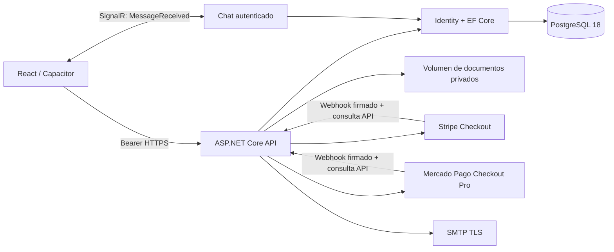
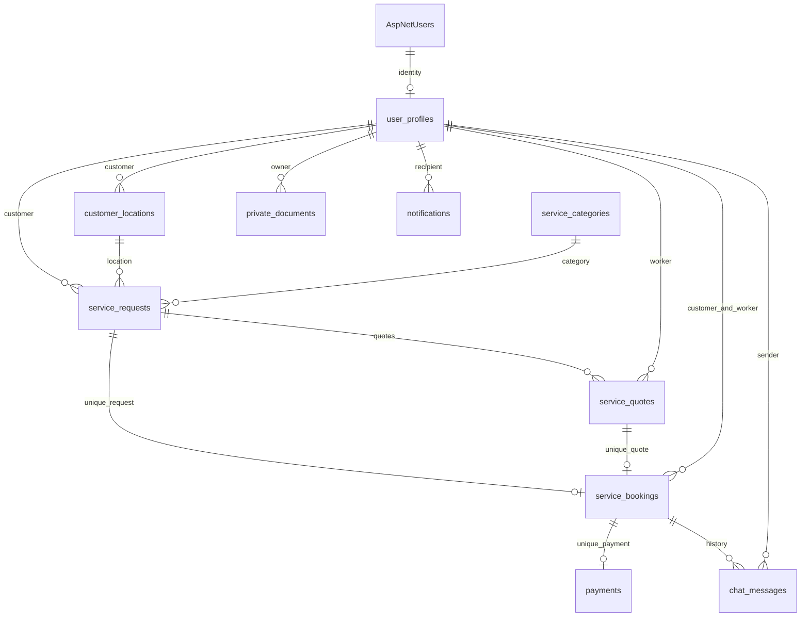

# Arquitectura y datos

La API conserva cuatro proyectos: Domain contiene entidades/reglas de estados; Application contiene contratos y abstracciones; Infrastructure implementa Identity/EF, archivos privados, proveedores de pagos y coordinación transaccional; Api compone servicios, valida HTTP, aplica autorización y expone REST/SignalR. Los controladores de los módulos nuevos hacen consultas EF a través de Infrastructure: es una arquitectura por capas pragmática, no una separación estricta de todos los casos de uso mediante repositorios.

## Relaciones del negocio

Hay 18 tablas funcionales: siete estándar de Identity, catálogo y diez de negocio. `audit_entries` guarda actor/acción/recurso sin copiar contraseñas, mensajes ni contenido de documentos. Se suma `__EFMigrationsHistory` para versionado.

## Invariantes

- Un perfil por usuario, rol Customer/Worker fijado al crear y alta de Admin por comando controlado.
- Documentos revisados antes de verificar trabajador; suspensión impide acciones y recepción de mensajes nuevos.
- Slug de categoría único, una cotización por trabajador/solicitud, una reserva por solicitud/cotización y un pago por reserva.
- Aceptación y cambios de estado transaccionales; Serializable protege disponibilidad y coordinación con pagos. Los conflictos se devuelven como 409, sin reintentar automáticamente operaciones financieras.
- Token de concurrencia en perfil, solicitud, reserva y pago; FKs restrictivas para evitar borrados en cascada del historial.
- Horarios guardados en UTC; importe decimal(12,2) y MXN para esta entrega.
- Las direcciones exactas no aparecen en oportunidades; solo los participantes de una reserva pueden consultarlas.
- Chat persistente y notificaciones en BD. SignalR distribuye a los IDs de usuario de los participantes activos; un cliente no elige destinatarios arbitrarios.
- Pago confirmado solo tras firma válida y consulta al proveedor, nunca por estado enviado por el cliente.

## Operación

Se prevé una instancia API con un volumen privado persistente. Para múltiples réplicas se requieren almacenamiento compartido, protección/compartición de claves Data Protection y backplane SignalR. No se incluyen despliegue automático, dispersión de pagos a trabajadores, push móvil ni escaneo antivirus externo. Estos límites se detallan en README y no se presentan como funcionalidades comprobadas.
